<p><picture><source media="(max-width: 600px)" srcset="assets/readme/hero-mobile.svg"/>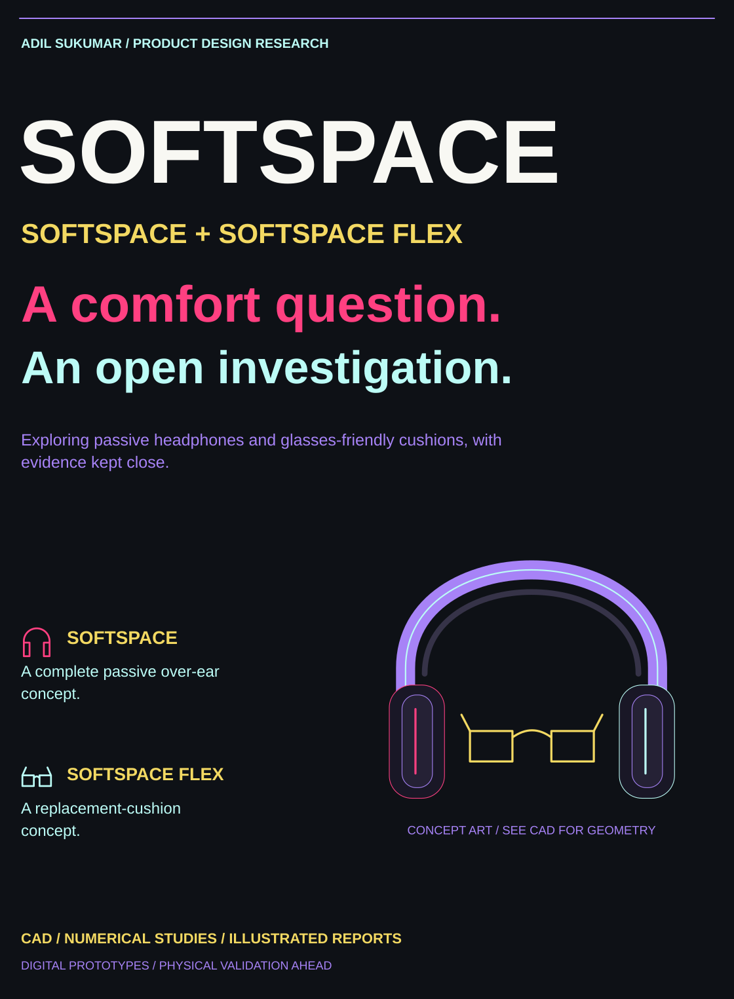</picture></p>

<p align="center"><a href="SoftSpace/README.md">SoftSpace</a> · <a href="SoftSpace%20Flex/README.md">SoftSpace Flex</a> · <a href="#the-evidence-so-far">Evidence</a> · <a href="#start-with-the-reports">Reports</a> · <a href="#complete-research-archive">V19 archive</a> · <a href="#what-happens-next">Next measurements</a></p>

<details>
<summary>Original project cover, badges and navigation</summary>

<p align="center">
  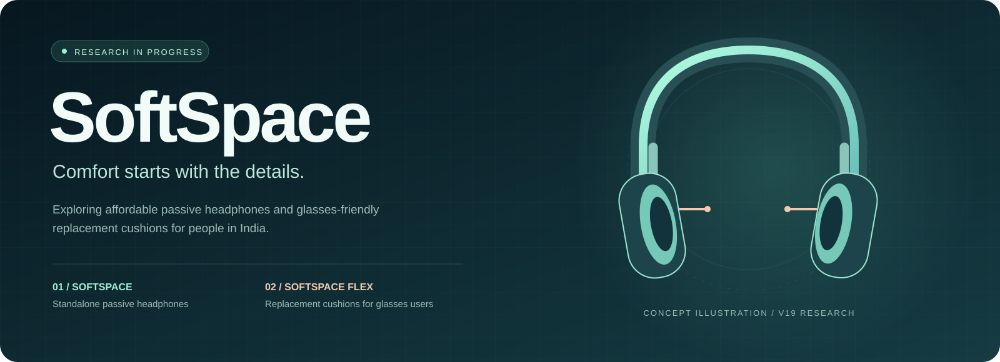
</p>

<p align="center">
  
  
  
  
</p>

<p align="center">
  <a href="SoftSpace/README.md"><strong>Explore SoftSpace</strong></a> &nbsp; · &nbsp;
  <a href="SoftSpace%20Flex/README.md"><strong>Explore SoftSpace Flex</strong></a> &nbsp; · &nbsp;
  <a href="#the-evidence-so-far">Test results</a> &nbsp; · &nbsp;
  <a href="#start-with-the-reports">Read the reports</a>
</p>


</details>

<!-- ORIGINAL-RESEARCH-NARRATIVE:BEGIN -->
<p><picture><source media="(max-width: 600px)" srcset="assets/readme/section-question-mobile.svg"/>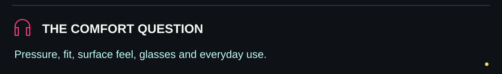</picture></p>

## Small details. A more comfortable possibility.

Loud surroundings can be overwhelming for some autistic people. A headphone can also introduce its own problems: heat, pressure, an awkward fit, an irritating surface, or a cushion pushing against glasses.

**SoftSpace explores those problems together.** The first priority is an affordable passive over-ear product for sound-sensitive autistic users in India. A second product route explores replacement cushions for people who wear glasses.

This repository makes the work inspectable: actual CAD, illustrated reports, numerical results, failures, source code and the measurements still needed.

**Current stage: a digital prototype for bench review.** Selected geometry and numerical checks have passed. Comfort, sensory acceptance, sound reduction, outgoing sound leakage, heat and long-term durability have not been demonstrated on real samples. The project is not a finished or certified product.

<p><picture><source media="(max-width: 600px)" srcset="assets/readme/section-routes-mobile.svg"/>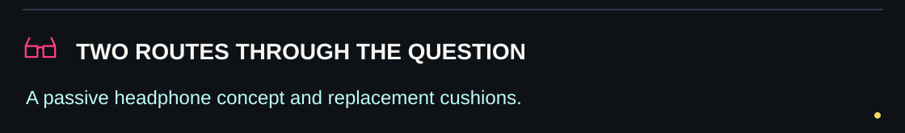</picture></p>


<!-- MATERIAL_LOADING:BEGIN -->
## Named material loading screen 26 October 2026

The [new material screen](SoftSpace/engineering/evidence/material-screen-2026-10-26/README.md) uses source-checked loading points for eight named Confor grades rather than an assumed foam law. Of 1152 cases, 559 are solved within the published strain range and 593 are left outside the supported domain. Cases with higher local pressure are retained. One 8 N reference gives about 35 percent lower calculated glasses-strip pressure with CF-40M in a CF-42M ring; this is a simplified uncovered 12.7 mm reference, **not pain relief, seal, fit or product validation**.

Both illustrated reports are updated together and native Word layouts checked. Grade availability and price in India are unverified. The loading-input gap has advanced; unloading, recovery, cover, mounting and full product gates remain open. Source URLs, hashes, extracted facts and all scenario results are published; manufacturer PDFs remain local for source checking.
<!-- MATERIAL_LOADING:END -->

<!-- VALIDATION_DECISION:BEGIN -->
## Software validation decision

**Neither product has passed full software validation or is approved for manufacturing release.** The evidence assessment is complete; outstanding tests are not complete. SoftSpace has unresolved joint strength and full assembly validation. Flex lacks verified Sony mounting geometry. Both routes still need qualified inputs and complete contact, sound, heat and durability models; wearer acceptance needs people.

The [decision and requirement register](SoftSpace/engineering/evidence/validation-decision/README.md) identifies existing evidence, missing inputs and acceptance requirements. Both Word reports contain the same final decision. This review reused saved results and ran no new simulation campaign. Further computation should address a specific changed design or newly qualified input; repeated assumed runs cannot supply missing measurements or mounting dimensions.
<!-- VALIDATION_DECISION:END -->

<!-- V26:BEGIN -->
## V26 rounded local joint trials

Two separate local CAD candidates investigate the failed stress predictions. Candidate A meets the fork mesh comparison but still fails the tongue checks, and introduces folding interference at two sampled angles. Candidate B relieves that corner and passes all 25 local folding samples plus both wearing-stop checks. These two-part candidates are **not integrated full headset releases**. Read the [CAD, raw fields and failure records](SoftSpace/engineering/evidence/engineering-v26-results/README.md).

Candidate B has **no accepted strength field**: low-memory solvers failed their accuracy gates, and the stronger attempt was stopped at a five-minute operational cap with about 8.7 GB committed. That stop does not prove physical weakness or mathematical divergence. Both illustrated Word reports are updated together and checked in native Word. The [remaining requirements](SoftSpace/engineering/evidence/engineering-v26-results/remaining_test_register.csv) still apply to both projects. **Full product software and physical validation remain open.** Sony fit, comfort, sound, heat and durability gains remain unproved.
<!-- V26:END -->

<!-- V25:BEGIN -->
## V25 surface calculation investigation

Three new child-large outward reference calculations test quadratic surface contact and consistent surface loads. All numerical consistency controls pass. Increasing integration accuracy changes sampled peaks by less than 0.4 percent, but mesh changes still give roughly 6 to 19 percent differences: **0 of 4 mesh comparisons pass** the chosen 5 percent check. This candidate does not fix reliable stress prediction or establish strength. Read the [pilot evidence and raw fields](SoftSpace/engineering/evidence/engineering-v25-results/README.md).

Both illustrated Word reports are updated together and checked in native Word. A [manufacturer input review](SoftSpace/engineering/evidence/engineering-v25-results/manufacturer_input_review.json) records specific BASF, Rogers and Sony sources; it does not turn typical data into a complete foam law or verified Sony mount. The [remaining requirements](SoftSpace/engineering/evidence/engineering-v25-results/remaining_test_register.csv) still include actual joint details, material condition, cushion contact, exact mounting, sound, heat and durability. **Neither product has full software or physical sign off.** No product performance or prototype purchase release is claimed.
<!-- V25:END -->

<!-- V24:BEGIN -->
## V24 corrected joint verification

Four new corrected virtual-spacer reference calculations use finer 1.5 mm target meshes on both joint families and load directions. Only 2 of 16 refined peak comparisons meet the fixed 5 percent limit. Their [raw results and stress comparisons](SoftSpace/engineering/evidence/engineering-v24-results/README.md) retain every failed comparison. Numerical consistency does not establish reliable whole-part stress or physical strength.

Primary CAD source loaders now resolve the moved workspace by recorded hashes. Four exact historical V12 sources are restored separately; all 304 recorded source path/hash pairs match. Both illustrated Word reports are updated together. Read the [remaining test register](SoftSpace/engineering/evidence/engineering-v24-results/remaining_test_register.csv): actual material curves, detailed joints, Sony mounting, sound and heat inputs remain unresolved. This completed numerical campaign is **not all product software testing completed**. No physical validation or product performance claim is added.
<!-- V24:END -->

<!-- V23:BEGIN -->
## V23 corrected joint verification

Eight new corrected virtual-spacer reference calculations cover two joint families, two meshes and both load directions. Their [raw results and stress comparisons](SoftSpace/engineering/evidence/engineering-v23-results/README.md) retain every failed comparison. Numerical consistency does not establish reliable whole-part stress or physical strength.

Both illustrated Word reports are updated together. Read the [remaining test register](SoftSpace/engineering/evidence/engineering-v23-results/remaining_test_register.csv): actual material curves, detailed joints, Sony mounting, sound and heat inputs remain unresolved. This completed numerical campaign is **not all product software testing completed**. No physical validation or product performance claim is added.
<!-- V23:END -->

<!-- V22:BEGIN -->
## V22 numerical confidence review

The [V22 results and test register](SoftSpace/engineering/evidence/engineering-v22-results/README.md) add higher-order integration, wider stress recovery, adaptive mesh quality, two targeted adult fork runs, contact rigid-motion controls and a corrected virtual-spacer reference. The earlier six stress passes applied only to 27 interior points; they do not establish reliable whole-part peaks. Exact corrected equilibrium statuses and failures remain in the saved records.

A whole-pad softer-foam control adds 25,272 assumed cases. In the 22,012 within the chosen compression range, none increases local or peak pressure in the reduced model; four show model detachment. This is a comparison candidate, not a selected material or a comfort, seal or acoustic result.

Both Word reports are updated together. Native Word exports and layout checks now supplement the earlier approximate previews. Part shapes stay at V19 for SoftSpace and V20 for Flex, with V21 carrying poses. **All possible software testing and product validation are not complete.** Actual material curves, mounting geometry, detailed contact and whole-product sound/heat/life models remain open.
<!-- V22:END -->

## V21 software review on 24 October 2026

**Software closure is not established.** The [new review and complete test register](SoftSpace/engineering/evidence/engineering-v21-results/README.md) adds 285 rigid motion samples, 126,360 assumed cushion-position scenarios, exact-area checks of every V20 row, and stresses recovered inside eight saved joint models. Both Word reports have the same update.

All added motion samples passed, and six smaller carrying poses passed sampled paths. The wider cushion study found pressure increases when glasses miss the soft zones. Four new finer joint solves pass six of eight sampled stress comparisons; both adult fork checks still fail, changing about 28 percent. The original coarser failures and rejected mesh remain recorded. Stable displacement is not a strength pass.

Further numerical stress review and material/mount inputs remain open. No final cushion winner, proven comfort, sound rating, Sony mounting fit or manufacturing release is claimed. V19 part shapes and the three V20 cushion bodies are unchanged; V21 adds six pose-only STEP exports. Do not interpret the prior small-sample plan as a finished-software or production approval.

## Previous V20 pre prototype review

**Small test samples are the next justified purchase.** SoftSpace keeps its V19 headphone geometry. SoftSpace Flex adds [three V20 reference pad bodies](SoftSpace%20Flex/CAD/V20-reference), using a published compatible-pad envelope of 100 x 80 x 30 mm. This is an aftermarket size, not a dimensioned Sony mounting drawing.

The [new evidence and purchase plan](SoftSpace/engineering/evidence/engineering-v20-results/README.md) includes 11,664 paired cushion scenarios, 12 separately implemented numerical comparisons, a fresh audit of eight saved joint solutions, source screenshots and recorded failures. Narrow-zone pressure, hinge-setting and tolerance risks are retained. The two Word reports now contain the same update.

This closes a bounded available-data study. Exact Sony attachment, calibrated worn contact, real acoustics, heat and durability remain input-dependent. No success probability, validated comfort benefit, zero-leakage result or manufacturing release is claimed. These records support an early prototype-funding proposal, not a proven-product claim.

## Two routes, one shared design question

<table>
  <tr>
    <th width="50%">01 &nbsp; SoftSpace</th>
    <th width="50%">02 &nbsp; SoftSpace Flex</th>
  </tr>
  <tr>
    <td align="center">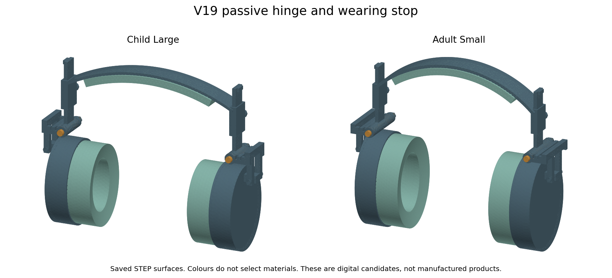</td>
    <td align="center"></td>
  </tr>
  <tr>
    <td><strong>A complete passive headphone concept</strong><br/>Six adjustable child/adult size variants, a folding mechanism and a developing cushion system. Autistic users are the first priority.</td>
    <td><strong>A replacement-cushion concept</strong><br/>A softer zone around glasses arms with a continuous cover. The first intended host is the Sony WH-CH720N. V20 explores a published aftermarket envelope; precise mounting dimensions are still required.</td>
  </tr>
  <tr>
    <td><a href="SoftSpace/README.md">Open product overview →</a><br/><a href="SoftSpace/reports/SoftSpace_Report.docx">Download illustrated Word report →</a></td>
    <td><a href="SoftSpace%20Flex/README.md">Open product overview →</a><br/><a href="SoftSpace%20Flex/reports/SoftSpace_Flex_Report.docx">Download illustrated Word report →</a></td>
  </tr>
</table>

*The product images above come from saved CAD. Colours show parts, not selected materials. Cushion surface triangles are the display mesh, not a proposed fabric texture. The cover illustration at the top is decorative concept artwork.*

<p><picture><source media="(max-width: 600px)" srcset="assets/readme/section-goals-mobile.svg"/>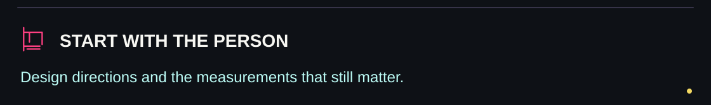</picture></p>

## What we are trying to improve

| Design question | Direction under investigation | What will establish whether it works |
| :--- | :--- | :--- |
| Pressure and fit | Adjustable sizes, headband compliance and cushion compression | Measured headband force, material curves and worn-fit checks |
| Glasses discomfort | A more compliant cushion zone around the glasses arm | Contact measurements and voluntary comparisons with the original pad |
| Noise and sealing | Passive cups and a continuous cushion cover | Repeated acoustic measurements with different fits and glasses |
| Heat and surface feel | Compare foam, cover, seam and padding options | Traceable samples, heat/moisture measurements and individual feedback |
| Carrying and robustness | Folding geometry, stops and a revised hinge proposal | Assembly checks, measured hinge torque, cycling and handling tests |
| Affordability in India | Simple construction and replaceable cushions | Supplier quotations, tooling costs, sourcing and prototype yield |

Autistic people have different sensory preferences. A design that works for one person may be uncomfortable for another. The project does not assume one universal fit, pressure or sound-reduction preference.

<p><picture><source media="(max-width: 600px)" srcset="assets/readme/section-evidence-mobile.svg"/>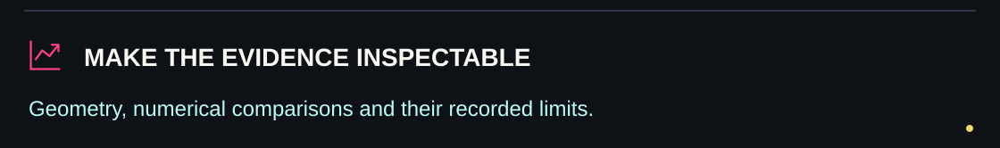</picture></p>

## The evidence so far

The latest standalone geometry is **V19**. The numerical results are conditional reference calculations; the reports explain the assumptions and earlier failures.

| Check | Recorded outcome | Practical limit |
| :--- | :--- | :--- |
| Six V19 assembly variants | 42 solids per assembly | CAD structure, not assembly or strength qualification |
| Folding/adjustment geometry | 189 sampled rigid poses and 24 outward-stop queries | Sampled poses do not prove every point in continuous motion clears |
| Saved pose exports | 18 wear/retracted/folded STEP files reimported and checked | Geometry and file checks only |
| Original 3D joint study | 22 current accepted solves; failed trials retained | Ideal pivot and prescribed preload; original linear mesh limits remain recorded |
| Boundary-alignment pilot | 8 recorded linear-solid cases | Did not resolve the earlier linear mesh sensitivity |
| Higher-order joint extension | 4 outward and 4 inward reference cases | Selected two-mesh displacement checks; no complete joint or wearer validation |

### Selected displacement comparisons

| Reference fixture | Child large | Adult small | Chosen numerical comparison |
| :--- | ---: | ---: | :--- |
| Outward load | 0.39% | 0.41% | Pass, below 5% |
| Inward load | 0.37% | 0.34% | Pass, below 5% |

These percentages describe **how much computed displacement changed between two meshes**. They are not comfort scores or improvements over another headphone. The fixtures use an assumed elastic PA66 reference, an ideal pivot, 140 N prescribed **joint preload**, friction coefficient 0.2 and a ±2 N side load. They are separate static cases, not a folding-cycle or load-reversal test.

All eight higher-order cases have saved-result audits. Passing these selected checks does not establish convergence of every stress, qualify the real fastener, calibrate the proposed hinge torque, or prove real sound isolation.

**Read the evidence:** [outward results](SoftSpace/engineering/evidence/engineering-v19-results/quadratic-contact/status.json) · [inward results](SoftSpace/engineering/evidence/engineering-v19-results/quadratic-inward/status.json) · [inward audits](SoftSpace/engineering/evidence/engineering-v19-results/quadratic-inward/verification.json) · [full workstream status](SoftSpace/engineering/evidence/engineering-v19-results/workstream_status.csv).

<p><picture><source media="(max-width: 600px)" srcset="assets/readme/section-fold-mobile.svg"/>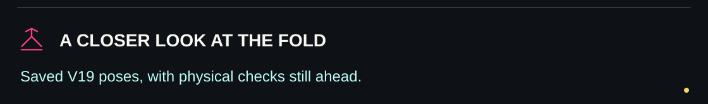</picture></p>

## A closer look at the fold

<p align="center">
  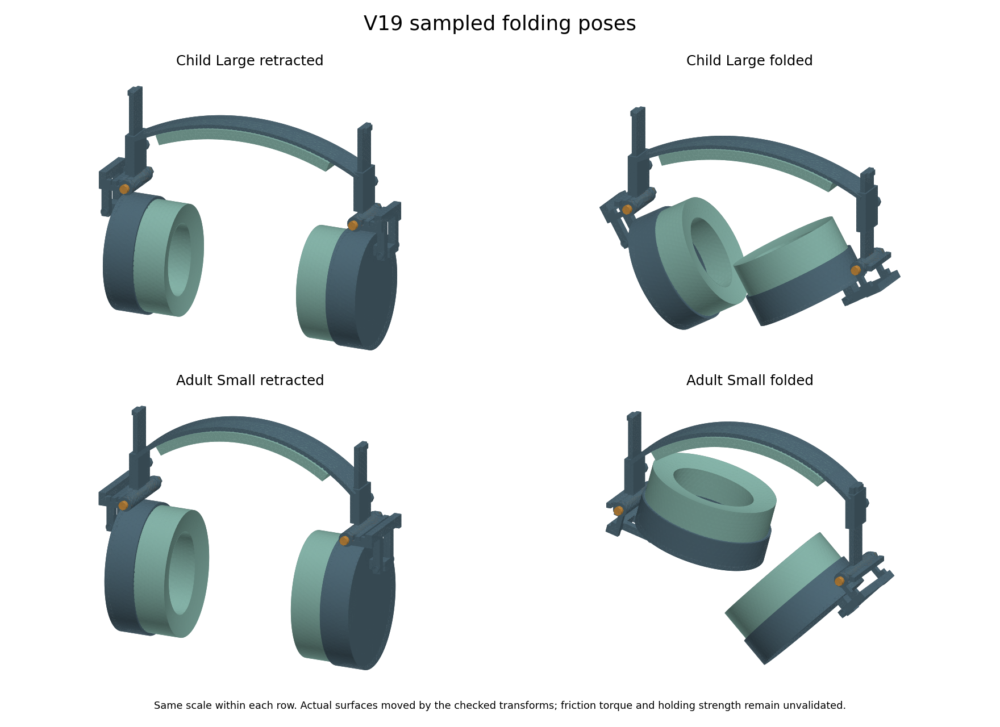
</p>

The saved poses illustrate the current folding proposal. Actual locking, tool access, friction, pin/washer behaviour and durability still need prototype checks. Proposed threads use cosmetic CAD envelopes; they are not manufacturing-ready thread geometry.

<p><picture><source media="(max-width: 600px)" srcset="assets/readme/section-reports-mobile.svg"/></picture></p>

## Start with the reports

| Document | What is inside |
| :--- | :--- |
| [**SoftSpace report**](SoftSpace/reports/SoftSpace_Report.docx) | User needs, selected market comparisons, version history, CAD pictures, numerical tests, failed trials and the next measurements |
| [**SoftSpace Flex report**](SoftSpace%20Flex/reports/SoftSpace_Flex_Report.docx) | Glasses/cushion problem, existing alternatives, continuous-cover concept, generic CAD, Sony measurement needs and leakage/fit test plan |
| [**Prototype handoff notes**](SoftSpace/engineering/evidence/engineering-v19-results/prototype-handoff/READ_FIRST.md) | Nominal hardware, assembly proposal, sample selection and bench-test sequence |
| [**Nominal dimension review**](SoftSpace/engineering/evidence/engineering-v19-results/prototype-handoff/Prototype_dimension_review.pdf) | Prototype dimensions for review; not a complete production drawing |
| [**Engineering guide**](SoftSpace/engineering/README.md) | File provenance, dependencies and how to materialize a workspace for saved-result checks |

The Word reports were checked structurally and through approximate rendered page previews. Native Word pagination remains unverified.

<p><picture><source media="(max-width: 600px)" srcset="assets/readme/section-archive-mobile.svg"/></picture></p>

## Complete research archive

[**Download the complete V19 research bundle (450 MB)**](https://github.com/adilsukumar/SoftSpace/releases/download/v19-research/SoftSpace_Complete_V19_Research.zip) for historical CAD and older raw numerical arrays. Git keeps the current CAD, both reports, source, result summaries and all eight higher-order saved solutions. The bundle includes 1,735 files and an integrity manifest; every recorded SHA-256 and ZIP CRC was checked before upload.

Bundle SHA-256: `13eb06a9162fab0dbcf2a6b495e84aa301b0f2840df34c2888a1e1d3e588914c`.

<p><picture><source media="(max-width: 600px)" srcset="assets/readme/section-map-mobile.svg"/>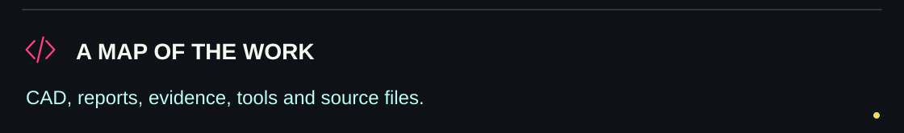</picture></p>

## Repository map

```text
SoftSpace/
├── README.md
├── reports/                  Illustrated SoftSpace report
├── CAD/
│   ├── V19/                  Six current assemblies and 18 saved poses
│   └── V10-native/           Earlier editable Fusion archives
├── media/                    Saved CAD views and research figures
└── engineering/
    ├── evidence/             Recorded results, arrays, failures and blank forms
    ├── CAD/                  Current V19 analysis-source CAD
    ├── sources/              Simulation, CAD and report-authoring scripts
    ├── figures/              Figures used in the living reports
    ├── tools/                Workspace preparation and repository verification
    └── publication_manifest.json

SoftSpace Flex/
├── README.md
├── reports/                  Illustrated SoftSpace Flex report
├── CAD/generic-V8/           Generic cushion candidates; Sony fit unverified
├── measurements/            Blank measurement and sample-test records
└── media/                    Cushion view and measurement guide
```

Shared calculations live in `SoftSpace/engineering` so both routes refer to the same evidence. Historical technical filenames are preserved there for traceability. Installed libraries, cached wheels, temporary screenshots and duplicate release ZIPs are excluded.

<details>
<summary><strong>Design history at a glance</strong></summary>

| Stage | Main focus |
| :--- | :--- |
| V1–V9 | Cushion concepts, continuous-cover exploration, extendable sizes and early structural screens |
| V10 | Native Fusion candidates and actual-width component fixtures |
| V11–V14 | Materials, folding geometry, locks and service-cap experiments; rejected routes retained |
| V15–V17 | Retention, packing, index holes and entry pilots |
| V18 | Passive hinge and wearing-stop proposal; handling and material screens |
| V19 | Parallel disc-spring proposal, revised pin/nuts, six-size exports and coupled joint calculations |

Current **V19 is STEP CAD**. The latest saved native editable Fusion archives remain **V10**. An illustration or file export is not a manufactured prototype.

</details>

<p><picture><source media="(max-width: 600px)" srcset="assets/readme/section-next-mobile.svg"/>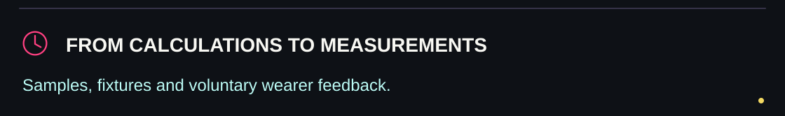</picture></p>

## What happens next

1. **Measure the Sony mount and original pad.** Complete the [model-specific form](SoftSpace%20Flex/measurements/Sony_WH_CH720N_measurements_REQUIRED.csv) before designing a compatible carrier.
2. **Obtain traceable material samples.** Measure foam compression/recovery, cover stretch/friction, headband force and hinge torque.
3. **Build a bench hinge and cushion sample.** Compare measurements with the models and revise the assumptions.
4. **Complete a fixture prototype.** Check fit, assembly, retention, acoustics, outgoing leakage, heat and durability.
5. **Collect voluntary wearer feedback.** Include individual sensory preferences, easy removal and glasses variations before making comfort or autism-related benefit claims.

The material work is a finite reference screen, not a test of every possible material. No novel material winner, lowest-cost claim, zero-leakage claim or superiority over market headphones has been established.

<p><picture><source media="(max-width: 600px)" srcset="assets/readme/section-contribute-mobile.svg"/></picture></p>

## Contributing evidence

Useful contributions include measured mounting dimensions, traceable material curves, reproducible fixture results and clearly documented model corrections. Include units, method, sample/grade, conditions and uncertainty. Keep simulations, manufacturer statements, physical measurements and wearer feedback separate.

See [CONTRIBUTING.md](CONTRIBUTING.md) for the evidence format and report-update rule.

---

<p align="center"><strong>SoftSpace · SoftSpace Flex</strong><br/>Built around a comfort question. Documented with evidence.<br/><sub>Working names; trademark clearance is incomplete. No open-source licence has been selected.</sub></p>


<!-- ORIGINAL-RESEARCH-NARRATIVE:END -->

<p><picture><source media="(max-width: 600px)" srcset="assets/readme/closing-mobile.svg"/>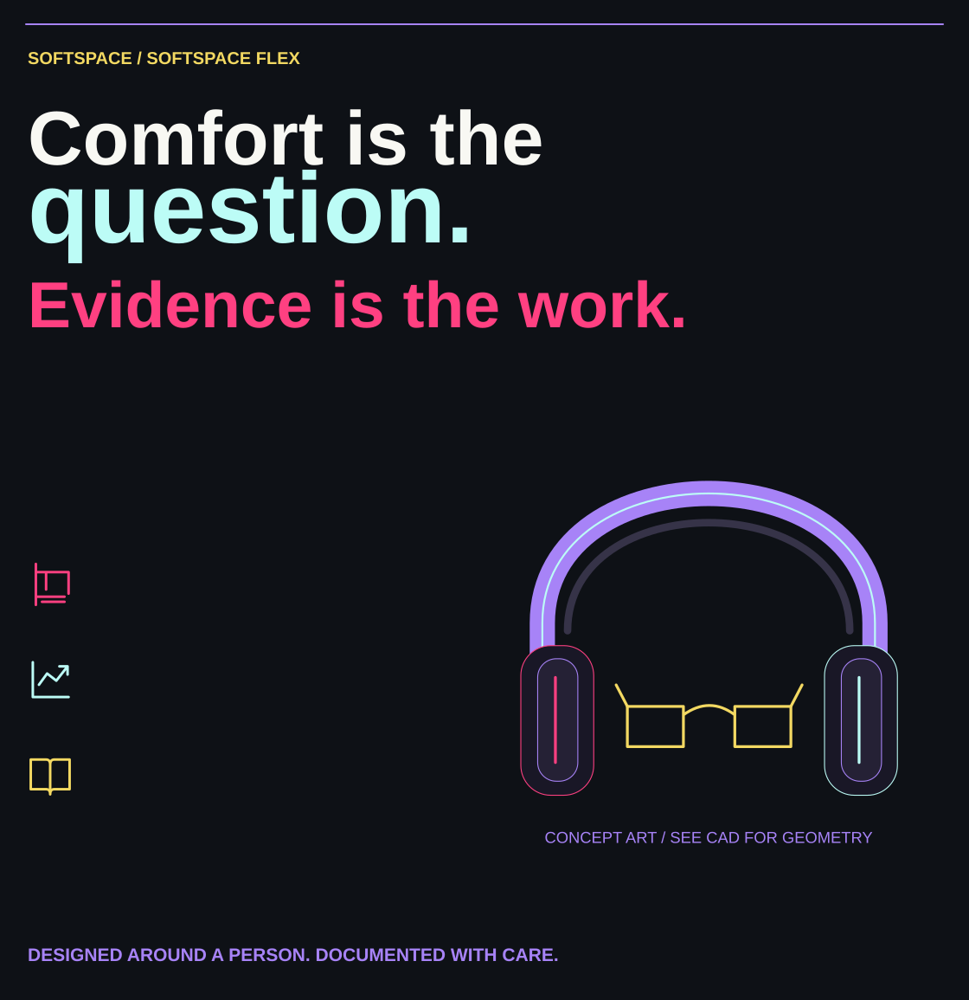</picture></p>
