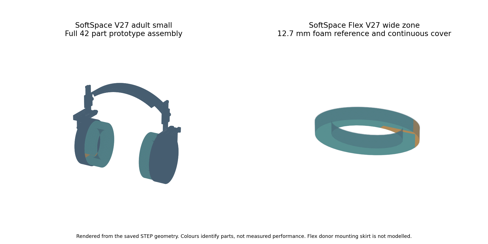

# SoftSpace Research Archive

<p align="center">  </p>

**Two comfort ideas, an inspectable engineering journey, and an honest final record.**

Closed on **27 October 2026** at the owner's request. Both ideas are retained as research projects; product and startup development have ended. This is a completed archive, not a claim of completed product validation.



## Explore the two projects

| Project | Investigation | Final saved work |
|---|---|---|
| [SoftSpace](SoftSpace/README.md) | Adjustable over-ear headset concept for sound-sensitive users | Six V27 STEP assemblies; sampled motion checks; unresolved joint strength; no ANC system |
| [SoftSpace Flex](SoftSpace%20Flex/README.md) | Replacement cushions intended to reduce pressure around glasses | Two V27 foam references; alignment sensitivity results; fit, comfort and acoustic performance unverified |

## Start here

- [Final findings and closure](FINAL_SUMMARY.md)
- [SoftSpace illustrated Word report](SoftSpace/reports/SoftSpace_Report.docx)
- [SoftSpace Flex illustrated Word report](SoftSpace%20Flex/reports/SoftSpace_Flex_Report.docx)
- [Engineering evidence and reproduction notes](SoftSpace/engineering/README.md)
- [Machine-readable final status](PROJECT_STATUS.json)

## What the work established

The latest headset CAD passed **189 recorded assembly, adjustment and folding samples** across six sizes. These finite rigid checks do not establish strength, continuous clearance or durability.

The latest glasses screen retained **840 scenarios**. The wider 32 mm soft zone lowered calculated mean glasses-arm pressure in **399 comparable cases** within the sourced material range. The narrower zone made some cases worse. These are simplified model outputs, not measured pain relief or success rates.

## What remains unproven

There were no physical prototype or wearer tests. No electronic ANC system was implemented. Reliable final joint strength, Sony mounting fit, sound isolation, outgoing leakage, heat, durability, cost and commercial viability remain unresolved. Earlier failures and unsupported cases are retained.

## Archive map

```text
SoftSpace/
  CAD/             V27 STEP assemblies and earlier versions
  reports/         Final illustrated report
  media/           CAD renders and figures
  engineering/     Sources, numerical data, failures and audit records
SoftSpace Flex/
  CAD/             V27 foam references and earlier cushion concepts
  reports/         Final illustrated report
  media/           Cushion figures
FINAL_SUMMARY.md    Final findings and limitations
PROJECT_STATUS.json
```

## Preserve the history

[Earlier project homepage](docs/history/2026-10-27/root_README.md) preserves the detailed development narrative. Its roadmaps and buying plans are historical, not active work. Previous CAD, results and failed experiments remain in the repository and Git history.

Working names have not completed trademark clearance. No open-source licence or patent clearance is implied. See [contribution and preservation notes](CONTRIBUTING.md).
