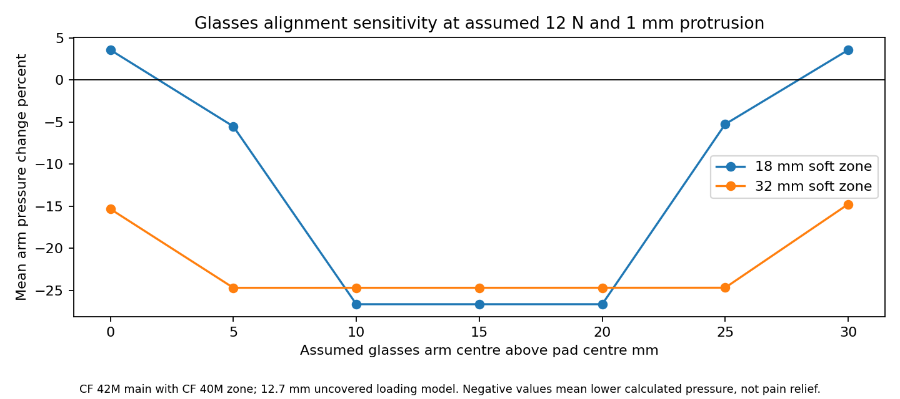

# SoftSpace Flex

**Closed research project — 27 October 2026.**

Replacement-cushion research intended to reduce glasses-arm pressure while retaining a useful acoustic seal. The intended first host was Sony WH-CH720N; an exact fitted replacement was not established.

| Read or inspect | Contents |
|---|---|
| [Final Word report](reports/SoftSpace_Flex_Report.docx) | Cushion history, evidence, limits and closure |
| [V27 reference CAD](CAD/V27-reference) | 12.7 mm foam references with 18 mm and 32 mm soft zones |
| [V20 reference CAD](CAD/V20-reference) | Earlier thicker cushion references |
| [Alignment results](../SoftSpace/engineering/evidence/engineering-v27-results/flex_alignment_summary.json) | All case counts, increases and exclusions |
| [Final project findings](../FINAL_SUMMARY.md) | Shared conclusions and research sources |

Of 840 scenarios, 799 had a comparable baseline and candidate inside the supported material range. The 18 mm zone lowered calculated pressure in 279/400 comparisons and increased it in 121. The 32 mm zone lowered it in 399/399 comparisons. These are uncovered independent-column calculations using manufacturer typical loading data, not pain relief, comfort or acoustic validation.

Both reference CAD variants passed recorded solid-validity and nominal nonoverlap checks. A continuous nominal cover is not proof of zero leakage. A donor mounting skirt was proposed but never fitted or tested. Original pads, ordinary soft pads and a zoned candidate were proposed comparison controls; no physical comparison was conducted.

No further development is planned. [Earlier route README](../docs/history/2026-10-27/SoftSpace_Flex_README.md) remains historical. [Back to both projects](../README.md).
