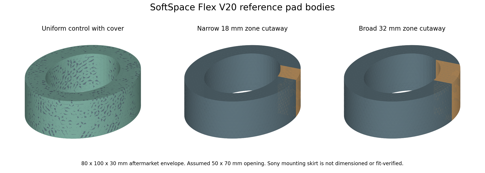
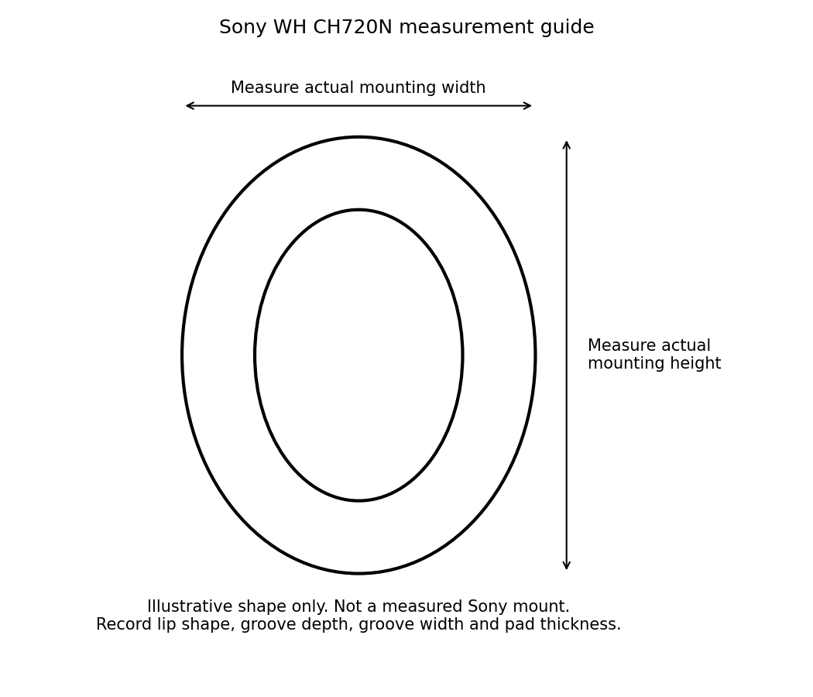

# SoftSpace Flex

**A glasses-friendly replacement-cushion concept for headphones with removable pads.**

[Read the illustrated report](reports/SoftSpace_Flex_Report.docx) · [Browse generic cushion CAD](CAD/generic-V8) · [Measurement forms](measurements) · [Back to the project](../README.md)

The aim is a more compliant zone around the glasses arm while maintaining a continuous cover and an acoustic seal. We are investigating material compliance and contact geometry. An open slot through the cover is not the intended solution.

**First intended host: Sony WH-CH720N.** V20 uses a published aftermarket pad envelope of 100 x 80 x 30 mm. The opening, cover and soft zones remain design assumptions. Exact groove/skirt dimensions are unavailable; a supplier can measure a model-specific reference pad without requiring the owner to measure now. No fitted Sony replacement or universal compatibility is claimed.

The visible triangles in the image are a display mesh, not a proposed fabric texture.

## V20 pre prototype update

[Open the evidence and first-purchase plan](../SoftSpace/engineering/evidence/engineering-v20-results/README.md) · [V20 body STEP files](CAD/V20-reference)

Three comparison bodies are saved: uniform, 18 mm zone and 32 mm zone. CAD reimport checks passed. A 12 mm zone in the separate scenario study could increase local pressure when misplaced; wider zones avoided that increase only within the stated assumed cases. Neither comfort nor a real seal is proven.

## What is saved

| Asset | Purpose | Limit |
| :--- | :--- | :--- |
| [Word report](reports/SoftSpace_Flex_Report.docx) | Existing alternatives, CAD history, material/contact idea and the test plan | No demonstrated pain reduction or acoustic pass |
| [Generic V8 CAD](CAD/generic-V8) | Earlier replacement-pad candidates | Carrier and skirt are not measured Sony interfaces |
| [Sony measurement form](measurements/Sony_WH_CH720N_measurements_REQUIRED.csv) | Record the original pad/mount geometry | Blank, not measured data |
| [Measured-input record](measurements/measured_inputs_REQUIRED.json) | Foam, cover, headband/hinge and acoustic inputs shared with SoftSpace | Blank fields must not be treated as values or test passes |
| [Shared engineering evidence](../SoftSpace/engineering/README.md) | Standalone and shared material/reference studies | Standalone joint results add no Sony pad-validation pass |

The guide is illustrative. Its oval is not a measured Sony mounting shape. Record mounting width/height, lip shape, groove depth/width, original pad depth, ear opening and attachment details before changing the carrier.

## How to establish an improvement

1. Measure the original host and make a carrier that fits and retains correctly.
2. Compare the original pad, a uniform replacement and the proposed softer-zone pad.
3. Use several glasses-arm shapes and repeated seating.
4. Measure contact and incoming sound reduction, plus outgoing playback leakage at matched inside-cup level.
5. Check frequency response and ANC on/off behaviour for the host headphone.
6. Check heat, sweat/cover behaviour, cleaning, attachment life and voluntary comfort feedback.

Replacement pads already exist, including alternatives discussed in the report. Affordability in India, a better glasses seal and reduced discomfort are objectives to demonstrate. Zero leakage, universal compatibility and superiority are unproven.

The six-size standalone folding design belongs to [SoftSpace](../SoftSpace/README.md). It is a separate product route, with shared learning rather than a claim that every result transfers to this pad.

## V21 software review

The [additional software review](../SoftSpace/engineering/evidence/engineering-v21-results/README.md) records wider glasses-position pressure risks and failed joint peak-stress comparisons. Further software work remains. Both reports are updated. Six carrying pose STEP exports are added; part shapes are unchanged. Six finer stress checks pass and two adult fork checks still fail.

<!-- VALIDATION_DECISION:BEGIN -->
## Software validation decision

**Neither product has passed full software validation or is approved for manufacturing release.** The evidence assessment is complete; outstanding tests are not complete. SoftSpace has unresolved joint strength and full assembly validation. Flex lacks verified Sony mounting geometry. Both routes still need qualified inputs and complete contact, sound, heat and durability models; wearer acceptance needs people.

The [decision and requirement register](../SoftSpace/engineering/evidence/validation-decision/README.md) identifies existing evidence, missing inputs and acceptance requirements. Both Word reports contain the same final decision. This review reused saved results and ran no new simulation campaign. Further computation should address a specific changed design or newly qualified input; repeated assumed runs cannot supply missing measurements or mounting dimensions.
<!-- VALIDATION_DECISION:END -->

<!-- V26:BEGIN -->
## V26 rounded local joint trials

Two separate local CAD candidates investigate the failed stress predictions. Candidate A meets the fork mesh comparison but still fails the tongue checks, and introduces folding interference at two sampled angles. Candidate B relieves that corner and passes all 25 local folding samples plus both wearing-stop checks. These two-part candidates are **not integrated full headset releases**. Read the [CAD, raw fields and failure records](../SoftSpace/engineering/evidence/engineering-v26-results/README.md).

Candidate B has **no accepted strength field**: low-memory solvers failed their accuracy gates, and the stronger attempt was stopped at a five-minute operational cap with about 8.7 GB committed. That stop does not prove physical weakness or mathematical divergence. Both illustrated Word reports are updated together and checked in native Word. The [remaining requirements](../SoftSpace/engineering/evidence/engineering-v26-results/remaining_test_register.csv) still apply to both projects. **Full product software and physical validation remain open.** Sony fit, comfort, sound, heat and durability gains remain unproved.
<!-- V26:END -->

<!-- V25:BEGIN -->
## V25 surface calculation investigation

Three new child-large outward reference calculations test quadratic surface contact and consistent surface loads. All numerical consistency controls pass. Increasing integration accuracy changes sampled peaks by less than 0.4 percent, but mesh changes still give roughly 6 to 19 percent differences: **0 of 4 mesh comparisons pass** the chosen 5 percent check. This candidate does not fix reliable stress prediction or establish strength. Read the [pilot evidence and raw fields](../SoftSpace/engineering/evidence/engineering-v25-results/README.md).

Both illustrated Word reports are updated together and checked in native Word. A [manufacturer input review](../SoftSpace/engineering/evidence/engineering-v25-results/manufacturer_input_review.json) records specific BASF, Rogers and Sony sources; it does not turn typical data into a complete foam law or verified Sony mount. The [remaining requirements](../SoftSpace/engineering/evidence/engineering-v25-results/remaining_test_register.csv) still include actual joint details, material condition, cushion contact, exact mounting, sound, heat and durability. **Neither product has full software or physical sign off.** No product performance or prototype purchase release is claimed.
<!-- V25:END -->

<!-- V24:BEGIN -->
## V24 corrected joint verification

Four new corrected virtual-spacer reference calculations use finer 1.5 mm target meshes on both joint families and load directions. Only 2 of 16 refined peak comparisons meet the fixed 5 percent limit. Their [raw results and stress comparisons](../SoftSpace/engineering/evidence/engineering-v24-results/README.md) retain every failed comparison. Numerical consistency does not establish reliable whole-part stress or physical strength.

Primary CAD source loaders now resolve the moved workspace by recorded hashes. Four exact historical V12 sources are restored separately; all 304 recorded source path/hash pairs match. Both illustrated Word reports are updated together. Read the [remaining test register](../SoftSpace/engineering/evidence/engineering-v24-results/remaining_test_register.csv): actual material curves, detailed joints, Sony mounting, sound and heat inputs remain unresolved. This completed numerical campaign is **not all product software testing completed**. No physical validation or product performance claim is added.
<!-- V24:END -->

<!-- V23:BEGIN -->
## V23 corrected joint verification

Eight new corrected virtual-spacer reference calculations cover two joint families, two meshes and both load directions. Their [raw results and stress comparisons](../SoftSpace/engineering/evidence/engineering-v23-results/README.md) retain every failed comparison. Numerical consistency does not establish reliable whole-part stress or physical strength.

Both illustrated Word reports are updated together. Read the [remaining test register](../SoftSpace/engineering/evidence/engineering-v23-results/remaining_test_register.csv): actual material curves, detailed joints, Sony mounting, sound and heat inputs remain unresolved. This completed numerical campaign is **not all product software testing completed**. No physical validation or product performance claim is added.
<!-- V23:END -->

<!-- V22:BEGIN -->
## V22 update

Read the [numerical confidence review](../SoftSpace/engineering/evidence/engineering-v22-results/README.md) and the updated Word report. New joint/model checks retain their failures; whole-pad softness is an added comparison control. Current geometry has no new physical, comfort, acoustic or manufacturing pass. Native Word pagination and layout were checked in this update.
<!-- V22:END -->

