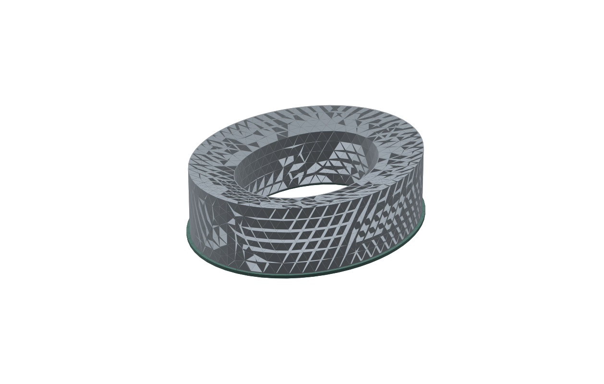

# SoftSpace Flex

**A glasses-friendly replacement-cushion concept for headphones with removable pads.**

[Read the illustrated report](reports/SoftSpace_Flex_Report.docx) · [Browse generic cushion CAD](CAD/generic-V8) · [Measurement forms](measurements) · [Back to the project](../README.md)

The aim is a more compliant zone around the glasses arm while maintaining a continuous cover and an acoustic seal. We are investigating material compliance and contact geometry. An open slot through the cover is not the intended solution.

**First intended host: Sony WH-CH720N.** The owner has deferred measuring the original pad and mounting interface. The current cushion CAD is generic; it is not a confirmed Sony-compatible replacement or a universal pad.

The visible triangles in the image are a display mesh, not a proposed fabric texture.

## What is saved

| Asset | Purpose | Limit |
| :--- | :--- | :--- |
| [Word report](reports/SoftSpace_Flex_Report.docx) | Existing alternatives, CAD history, material/contact idea and the test plan | No demonstrated pain reduction or acoustic pass |
| [Generic V8 CAD](CAD/generic-V8) | Earlier replacement-pad candidates | Carrier and skirt are not measured Sony interfaces |
| [Sony measurement form](measurements/Sony_WH_CH720N_measurements_REQUIRED.csv) | Record the original pad/mount geometry | Blank, not measured data |
| [Measured-input record](measurements/measured_inputs_REQUIRED.json) | Foam, cover, headband/hinge and acoustic inputs shared with SoftSpace | Blank fields must not be treated as values or test passes |
| [Shared engineering evidence](../SoftSpace/engineering/README.md) | Standalone and shared material/reference studies | Standalone joint results add no Sony pad-validation pass |

The guide is illustrative. Its oval is not a measured Sony mounting shape. Record mounting width/height, lip shape, groove depth/width, original pad depth, ear opening and attachment details before changing the carrier.

## How to establish an improvement

1. Measure the original host and make a carrier that fits and retains correctly.
2. Compare the original pad, a uniform replacement and the proposed softer-zone pad.
3. Use several glasses-arm shapes and repeated seating.
4. Measure contact and incoming sound reduction, plus outgoing playback leakage at matched inside-cup level.
5. Check frequency response and ANC on/off behaviour for the host headphone.
6. Check heat, sweat/cover behaviour, cleaning, attachment life and voluntary comfort feedback.

Replacement pads already exist, including alternatives discussed in the report. Affordability in India, a better glasses seal and reduced discomfort are objectives to demonstrate. Zero leakage, universal compatibility and superiority are unproven.

The six-size standalone folding design belongs to [SoftSpace](../SoftSpace/README.md). It is a separate product route, with shared learning rather than a claim that every result transfers to this pad.
